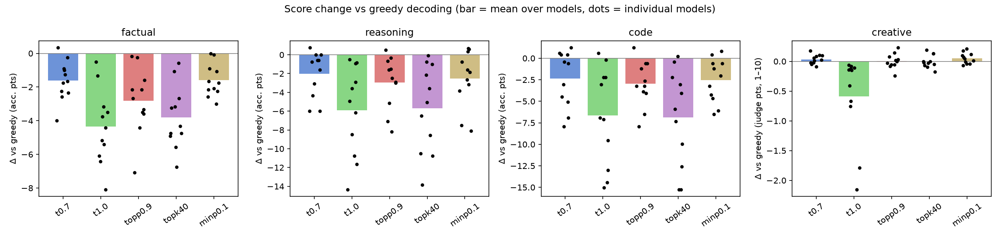
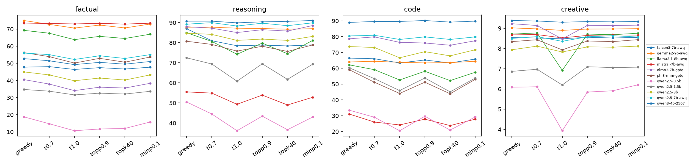
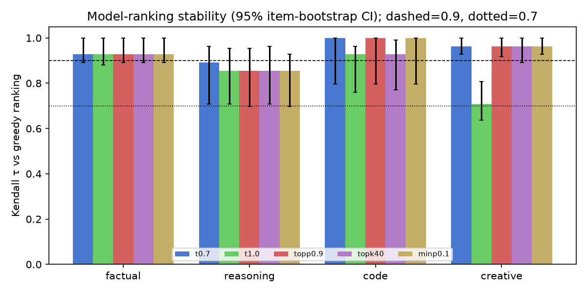
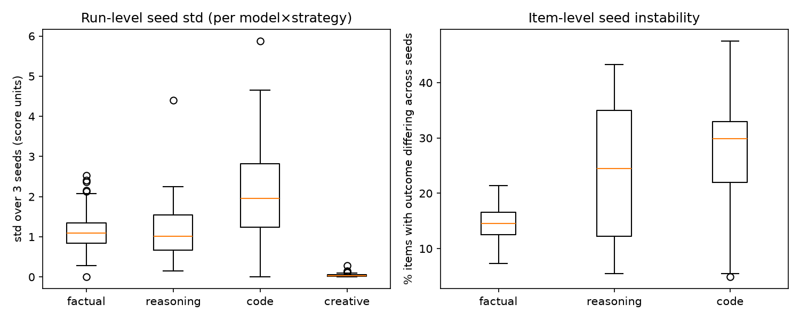

# Decoding Strategy Sensitivity Across Task Domains — Research Report

## 1. Executive Summary

**Question.** How much do LLM task scores and model *rankings* change with the decoding strategy, and does this differ between factual QA, math reasoning, code synthesis and creative writing?

**Setup.** 11 open-weight instruction-tuned LLMs (7 families, 0.5B–9B) × 4 domains × 6 decoding strategies (greedy, T=0.7, T=1.0, top-p 0.9, top-k 40, min-p 0.1; each sampled strategy run with 3 seeds). That is 132k generations, all served locally with vLLM.

**Main finding.** Every sampling strategy lowered accuracy relative to greedy decoding in **all three verifiable domains**. Pure T=1.0 and top-k 40 did the most damage, while top-p 0.9, min-p 0.1 and T=0.7 recovered roughly half or more of that loss. Five specific claims were tested; the evidence for each:

| # | Hypothesis claim | Result | Verdict |
|---|---|---|---|
| H1 | Factual QA drops <2% under all strategies | Mean drop 1.6 (T=0.7, min-p) to 4.3 points (T=1.0), i.e. 4–11% relative; per-model drops up to 8.1 points; all significant (Holm-corrected p<0.04) | **Refuted** (holds only for T=0.7/min-p, and only on average) |
| H2 | Reasoning drops 5–12 points from greedy to T=1.0; top-p 0.9 recovers most of the gap | Mean gap **5.9 points** (per model 0.5–14.3); top-p recovers **50%** pooled, min-p 57% | **Mostly supported** for the mean gap; recovery is about half, not "most" |
| H3 | Creative quality +10–15% with sampling | LLM-judge score changes **+0.0% to +0.7%** for T=0.7, top-p, top-k and min-p (n.s.); **−7.9%** at T=1.0 (p=0.02) | **Refuted** |
| H4 | Ranking τ > 0.9 on factual, τ < 0.7 on reasoning | Factual τ = **0.93** for every strategy (95% CI ≈ 0.88–1.0); reasoning τ = **0.86–0.89** (CI ≈ 0.70–0.96) | **Half supported**: factual is stable, and reasoning is *less* stable, but well above 0.7 |
| H5 | Code has the highest seed variance under sampling | Code seed SD 2.13 points vs 1.16 reasoning and 1.14 factual (p<1e-5); with matched n=164 items: 2.13 vs 1.85 and 1.59 | **Supported**, but much of the raw gap comes from the smaller test set; the matched-n margin over reasoning is small |

**Practical implication.** Greedy decoding is the best choice for verifiable tasks on these models. If sampling is needed, use top-p 0.9, min-p 0.1 or T≤0.7, never raw T=1.0 or top-k 40. Leaderboard rankings are robust (τ≥0.85 vs greedy in every domain except creative at T=1.0), but individual models can swing by 8–15 points. Comparing two models under different decoding settings can therefore flip the conclusion.

## 2. Research Question & Motivation

LLM benchmark numbers are reported under heterogeneous and often unstated decoding settings: greedy for leaderboards, T≈0.7 for chat, pass@1 with T=0.2–0.8 for code. If a domain's scores, or worse its *rankings*, depend on the decoder, then cross-paper comparisons in that domain are fragile. Practitioners also need to know which sampler to use when diversity is needed.

**Gap.** Prior work mostly studies one domain at a time:
- Holtzman et al. 2020 introduced nucleus sampling for open-ended text.
- Chen et al. 2021 (Codex) studied temperature vs pass@k.
- Renze & Guven 2024 found temperature has little effect on MCQA.
- Nguyen et al. 2024 proposed min-p.
- Shi et al. 2024, "A Thorough Examination of Decoding Methods in the Era of LLMs", covers several tasks but few models and no ranking analysis.

A single controlled grid over models × domains × samplers × seeds that measures **ranking stability (Kendall τ)** and **seed variance** per domain had not been done. (The automated resource-finding stage was skipped for this workspace, so the literature context is from background knowledge rather than a fresh search.)

## 3. Experimental Setup

### Models (all instruction-tuned, served with vLLM 0.32, local GPUs)
| key | checkpoint |
|---|---|
| qwen2.5-0.5b / 1.5b / 3b | Qwen/Qwen2.5-{0.5B,1.5B,3B}-Instruct (bf16) |
| qwen2.5-7b-awq | Qwen/Qwen2.5-7B-Instruct-AWQ |
| qwen3-4b-2507 | Qwen/Qwen3-4B-Instruct-2507 (bf16) |
| llama3.1-8b-awq | hugging-quants/Meta-Llama-3.1-8B-Instruct-AWQ-INT4 |
| gemma2-9b-awq | hugging-quants/gemma-2-9b-it-AWQ-INT4 |
| mistral-7b-awq | solidrust/Mistral-7B-Instruct-v0.3-AWQ |
| falcon3-7b-awq | tiiuae/Falcon3-7B-Instruct-AWQ |
| phi3-mini-gptq | kaitchup/Phi-3-mini-4k-instruct-gptq-4bit |
| olmo3-7b-gptq | kaitchup/Olmo-3-7B-Instruct-gptq-w4a16-g128 |

**Why local open models rather than GPT/Claude/Gemini APIs?** No API keys (OpenRouter/OpenAI) were available on this host. Open models also give exact control over the samplers (top-k and min-p are not exposed by most closed APIs) and per-request seeds. The models are real LLMs, not simulations, but they are small (≤9B) and 4-bit-quantized in 7 of 11 cases (see Limitations).

### Decoding strategies
| name | parameters |
|---|---|
| greedy | T=0 (1 run) |
| t0.7 | T=0.7 |
| t1.0 | T=1.0 (pure ancestral sampling) |
| topp0.9 | T=1.0, top-p=0.9 |
| topk40 | T=1.0, top-k=40 |
| minp0.1 | T=1.0, min-p=0.1 |

Each sampled strategy was run with 3 seeds (per-request seed = 100000·seed + item index, so results don't depend on batching). That gives 16 runs per model × task.

### Tasks and metrics
| domain | data | n | metric | max new tokens |
|---|---|---|---|---|
| Factual QA | TriviaQA rc.nocontext validation, random sample (seed 42) | 400 (398 unique ids) | Normalised alias match on the first line of the answer (EM or alias contained in the answer) | 48 |
| Reasoning | GSM8K test, random sample | 400 | Accuracy of the final number (prefers "The answer is N"), zero-shot chain-of-thought | 640 |
| Code | HumanEval (all) | 164 | pass@1: prompt + extracted code + unit tests executed in an isolated subprocess (10 s timeout) | 640 |
| Creative | ROCStories test first sentences → "write a ~150-word story" | 100 | LLM-judge mean of creativity, coherence, fluency and engagement (1–10); also distinct-2 and length | 400 |

All prompts are zero-shot, use each model's chat template, and are identical across models and strategies (`src/common.py::make_prompt`).

**Creative judge (the "human-judged proxy").** Qwen3-8B-AWQ in non-thinking mode, greedy, rubric prompt in `src/judge.py`. It is not one of the evaluated models and is blind to model and strategy. All 17,600 judgments parsed (0 failures). A 14B judge was planned but did not fit the shared GPUs.

### Statistics
- Model-level scores average items within each run, then average over seeds.
- Δ vs greedy is tested across the 11 models with Wilcoxon signed-rank (and a t-test), with Holm correction over all 20 (domain, strategy) tests.
- Kendall τ_b compares the greedy model ranking with each strategy's ranking. 95% CIs come from 1,000 item-bootstrap resamples, recomputing all model means each time.
- Seed variance is measured as the SD over the 3 seeds of run-level accuracy, plus the per-item "flip rate" (share of items whose outcome differs across seeds). A matched-n robustness check subsamples factual and reasoning to 164 items (200 subsamples).

### Compute
- 4× RTX A6000 (48 GB) shared with other users' jobs. Each model got a 5–15 GB slice: gpu_memory_utilization adapted to free memory, max_model_len 2048, max_num_seqs 128.
- 132,064 generations, about 28.6M generated tokens.
- Generation took about 4.5 h wall-clock (dominated by GPU contention); judging took about 45 min.
- API cost: $0.

## 4. Results

### 4.1 Mean scores per strategy (average over 11 models)

| domain (unit) | greedy | T=0.7 | T=1.0 | top-p 0.9 | top-k 40 | min-p 0.1 |
|---|---|---|---|---|---|---|
| Factual (acc %) | **51.8** | 50.2 | 47.4 | 49.0 | 48.0 | 50.2 |
| Reasoning (acc %) | **79.3** | 77.2 | 73.3 | 76.3 | 73.5 | 76.7 |
| Code (pass@1 %) | **63.5** | 61.2 | 56.9 | 60.6 | 56.6 | 61.0 |
| Creative (judge, 1–10) | 8.30 | 8.33 | 7.71 | 8.30 | 8.30 | **8.35** |

### 4.2 Change vs greedy (mean over models [min, max]; relative % in parentheses)

| domain | T=0.7 | T=1.0 | top-p 0.9 | top-k 40 | min-p 0.1 |
|---|---|---|---|---|---|
| Factual (pts) | −1.6 [−4.0, +0.3] (−4.3%)* | −4.3 [−8.1, −0.5] (−11.0%)* | −2.8 [−7.1, −0.2] (−7.7%)* | −3.8 [−6.8, −0.6] (−9.4%)* | −1.6 [−3.0, 0.0] (−4.0%)* |
| Reasoning (pts) | −2.0 [−6.0, +0.8] (−2.9%) | −5.9 [−14.3, −0.5] (−8.6%)* | −2.9 [−8.2, +0.5] (−4.1%)* | −5.7 [−13.8, −0.1] (−8.3%)* | −2.5 [−8.1, +0.7] (−3.7%) |
| Code (pts) | −2.3 [−7.9, +1.2] (−5.2%) | −6.7 [−15.0, +0.6] (−13.2%)* | −3.0 [−7.9, +1.2] (−5.7%) | −6.9 [−15.2, +0.2] (−13.6%)* | −2.5 [−6.5, +0.8] (−5.1%) |
| Creative (judge pts) | +0.03 (+0.5%) | −0.59 [−2.15, −0.06] (−7.9%)* | +0.00 (+0.0%) | +0.00 (+0.0%) | +0.05 (+0.7%) |

\* Wilcoxon over the 11 models, Holm-adjusted p < 0.05 (full table in `results/analysis/delta_tests.csv`).

*Figure 1. Change vs greedy per domain and strategy. Bars are the mean over models; dots are individual models.*

*Figure 2. Per-model scores across strategies.*

**Reasoning gap and recovery (H2).** Greedy − T=1.0 per model:

| model | gap (pts) |
|---|---|
| qwen2.5-0.5b | 14.3 |
| qwen2.5-1.5b | 11.7 |
| llama3.1-8b | 10.8 |
| falcon3-7b | 8.5 |
| mistral-7b | 6.2 |
| phi3-mini | 4.9 |
| qwen2.5-3b | 3.6 |
| olmo3-7b | 2.9 |
| qwen2.5-7b | 0.9 |
| qwen3-4b | 0.8 |
| gemma2-9b | 0.5 |

Only 4/11 models fall inside the hypothesised 5–12-point band. The gap shrinks with model strength: the strongest reasoners (Qwen3-4B, Qwen2.5-7B, Gemma-2-9B) lose under 1 point. Pooled over models, top-p 0.9 recovers **50%** of the T=1.0 loss and min-p 0.1 recovers **57%**.

### 4.3 Ranking stability (H4)

| domain | T=0.7 | T=1.0 | top-p 0.9 | top-k 40 | min-p 0.1 | mean τ over all 15 strategy pairs |
|---|---|---|---|---|---|---|
| Factual | 0.93 [0.89, 1.0] | 0.93 [0.88, 1.0] | 0.93 [0.89, 1.0] | 0.93 [0.89, 1.0] | 0.93 [0.89, 1.0] | 0.98 |
| Reasoning | 0.89 [0.71, 0.96] | 0.85 [0.71, 0.95] | 0.85 [0.70, 0.95] | 0.85 [0.71, 0.96] | 0.85 [0.70, 0.93] | 0.91 |
| Code | 1.00 [0.80, 1.0] | 0.93 [0.76, 0.96] | 1.00 [0.80, 1.0] | 0.93 [0.77, 0.99] | 1.00 [0.80, 1.0] | 0.96 |
| Creative | 0.96 [0.93, 1.0] | **0.71 [0.64, 0.81]** | 0.96 [0.92, 1.0] | 0.96 [0.89, 1.0] | 0.96 [0.93, 1.0] | 0.88 |

(Kendall τ vs the greedy ranking; 95% item-bootstrap CI in brackets.)

*Figure 3. Kendall τ between each strategy's model ranking and the greedy ranking.*

Reasoning has the least stable rankings among the verifiable domains. Only 10–20% of bootstrap replicates exceed τ=0.9, versus 85–97% for factual. But τ never approaches 0.7. Reasoning rankings are fragile because the top models are tightly packed (Qwen3-4B 95%, Qwen2.5-7B 91%, Olmo-3 90%, Gemma-2 89% under greedy), so small seed-level noise swaps neighbours. The only domain/strategy combination near τ=0.7 is **creative at T=1.0**: small models degenerate there (Qwen2.5-0.5B −35%, Llama-3.1-8B −21% judge score) while larger ones do not.

### 4.4 Seed variability (H5)

| domain | items | seed SD (pts) | seed range (pts) | item flip rate | SD / binomial SE |
|---|---|---|---|---|---|
| Code | 164 | **2.13** | 4.08 | **26.7%** | **0.61** |
| Reasoning | 400 | 1.16 | 2.21 | 24.2% | 0.58 |
| Factual | 398 | 1.14 | 2.18 | 14.4% | 0.49 |
| Creative (judge pts) | 100 | 0.05 | 0.09 | (item judge-SD 0.47) | – |

Statistics are averaged over the 11 models × 5 sampled strategies. Code > factual and code > reasoning on both seed SD and flip rate (paired Wilcoxon over the 55 model×strategy cells: p < 1e-5, except flip rate code vs reasoning, p = 0.02).

With **matched n=164** (`results/analysis/seed_std_matched_n.csv`):

| domain | seed SD (pts) | 95% interval over subsamples |
|---|---|---|
| Code | 2.13 | – |
| Reasoning | 1.85 | [1.61, 2.20] |
| Factual | 1.59 | [1.30, 2.05] |

Code remains the most seed-sensitive domain, but its lead over reasoning is modest.

*Figure 4. Seed variability by domain.*

### 4.5 Creative breakdown (H3)

| strategy | creativity | coherence | fluency | engagement | mean | distinct-2 | words | truncated |
|---|---|---|---|---|---|---|---|---|
| greedy | 7.24 | **8.36** | **9.47** | 8.13 | 8.30 | 0.963 | 148 | 1.6% |
| T=0.7 | 7.39 | 8.31 | 9.44 | 8.20 | 8.33 | 0.973 | 151 | 1.8% |
| T=1.0 | 7.29 | 7.37 | 8.56 | 7.64 | 7.71 | **0.982** | 156 | 4.5% |
| top-p 0.9 | 7.47 | 8.20 | 9.34 | 8.20 | 8.30 | 0.977 | 154 | 2.8% |
| top-k 40 | **7.53** | 8.15 | 9.31 | **8.22** | 8.30 | 0.979 | 156 | 2.7% |
| min-p 0.1 | 7.39 | 8.35 | 9.46 | 8.21 | **8.35** | 0.973 | 153 | 2.0% |

Sampling does raise the judge's **creativity** sub-score (+2 to +4%) and lexical diversity, but it costs coherence and fluency. The overall score is therefore flat (truncated samplers) or worse (raw T=1.0). Nothing approaches +10–15%.

## 5. Analysis & Discussion

**Sampling hurts verifiable tasks, and the sampler matters more than the domain.** The ordering of strategies was nearly identical in every verifiable domain: greedy > {T=0.7, min-p, top-p} > {top-k 40, T=1.0}. Top-k 40 behaves almost exactly like raw T=1.0, because 40 tokens is too permissive a cut-off for peaked instruction-model distributions. Top-p and min-p are adaptive and remove the long tail that produces off-track tokens.

**Factual QA is not decoding-invariant (H1 refuted).** Pooled over models, items answered correctly under greedy remained correct on only 87% of T=1.0 samples. Items answered wrongly under greedy became correct on only 5% of samples. Sampling therefore mostly converts confident correct answers into plausible wrong ones and almost never rescues a miss, so the expected score can only fall. Relative to its lower base accuracy (52%), factual QA lost about as much in *relative* terms (−11% at T=1.0) as reasoning (−9%). The hypothesis that short-answer factual recall is robust holds only for mild samplers (T=0.7, min-p ≈ −1.6 points, i.e. near the 2-point bound on average but not for every model).

**Reasoning (H2) shows the hypothesised magnitude on average, but it is model-dependent.** The mean greedy→T=1.0 loss (5.9 points) sits in the predicted 5–12 range. However, the loss is large for weak and mid-sized models and close to zero for the strongest ones, which presumably have sharper next-token distributions on their CoT traces. Top-p 0.9 recovers half of the gap, and min-p slightly more.

**Rankings (H4).** The qualitative direction is right: rankings are most stable on factual QA and least stable on reasoning among the verifiable tasks. The magnitude is not: reasoning τ ≈ 0.85–0.89, not < 0.7. Ranking instability is driven by how tightly the models cluster, not by the domain per se. With 11 models, a single swapped pair moves τ by 0.036.

**Code (H5)** is the noisiest domain across seeds, both per run and per item. More than a quarter of HumanEval problems change pass/fail between seeds for the same model and sampler. One reason is that a single wrong token often breaks a program. The other is that the benchmark is small, which explains about half of the raw difference.

**Creative (H3).** Under this LLM-judge proxy, greedy stories from instruction-tuned models are already fluent and coherent. Sampling adds diversity and some originality, but the rubric weights coherence and fluency equally. Sampling therefore never produced the predicted 10–15% gain. Untruncated T=1.0 visibly degrades small models; for example, Qwen2.5-0.5B stories drift into word salad ("Dory's repertoire of species expert claim proved invaluable…"), and 27% of its stories hit the length cap. Whether human readers would weigh creativity more heavily is untested.

**Surprises.**
1. Factual QA was about as decoding-sensitive as reasoning in relative terms.
2. Min-p 0.1 was the best sampler overall: closest to greedy on every verifiable task, and the highest creative score.
3. The creative domain, not reasoning, produced the only τ near 0.7, because of degeneration of small models at T=1.0.

## 6. Limitations

- **Model scale and quantization.** All models are ≤9B and 7/11 are 4-bit quantized. Frontier API models (GPT-4.1/5, Claude, Gemini) could not be tested because no API keys were available, and their sensitivity is likely smaller (the strongest models here were already insensitive on reasoning).
- **Judge proxy.** Creative quality is scored by a single 8B LLM judge, not by humans. LLM judges favour fluent, coherent text and may under-reward novelty. Diversity metrics are reported alongside, but H3's "human-judged" claim is only tested by proxy. The judge (Qwen3) shares a family with 5 evaluated Qwen models.
- **Sample sizes.** 400/400/164/100 items, 3 seeds, 11 models. τ CIs are wide (±0.15 for reasoning), and with 11 models τ is coarse-grained (0.036 per swap).
- **Greedy is a single run.** vLLM batching can make "greedy" slightly non-deterministic. Comparisons of greedy (1 run) vs sampled strategies (3-seed means) therefore have unequal variance; the Δ tests average out seed noise but not greedy-run noise.
- **Metric artefacts.** TriviaQA alias matching on the first line of the answer and last-number extraction on GSM8K are standard but imperfect. Two TriviaQA questions appear twice in the sample (398 unique ids). Truncation (max tokens) affects T=1.0 slightly more (3–4.5% vs 1.6–2% for greedy).
- **Prompting.** Single zero-shot prompt per task; sensitivity to prompt wording was not examined.
- **Literature.** The literature context comes from background knowledge (the resource-finder stage did not run); no systematic search was done.

## 7. Conclusions & Next Steps

For small and mid-sized open instruction models, decoding strategy is **not** a negligible nuisance variable for any verifiable domain:
- Untruncated sampling costs 4–7 points on factual QA, GSM8K and HumanEval.
- Truncated samplers (top-p, min-p) halve that cost.
- No sampler beat greedy on average.
- Creative quality under an LLM-judge proxy does not improve with sampling.

Model rankings are reassuringly stable (τ ≥ 0.85 vs greedy for every verifiable domain/strategy). Reasoning is the least stable, but far from the hypothesised τ < 0.7. Code is the most seed-sensitive domain.

**Recommendations.**
- Always report decoding settings.
- Use greedy (or min-p/top-p) for evaluation.
- Average ≥3 seeds when sampling, especially for code.

**Follow-ups.**
1. Repeat with frontier API models and unquantized weights.
2. Human ratings (or a panel of judges) for creative quality.
3. More models (≥20) for tighter τ estimates.
4. Larger code benchmarks (MBPP+, LiveCodeBench) to separate inherent code noise from small-n effects.
5. Temperature sweeps to locate where each domain's loss begins.

## References
- Holtzman et al. (2020). The Curious Case of Neural Text Degeneration. ICLR.
- Chen et al. (2021). Evaluating Large Language Models Trained on Code (HumanEval).
- Cobbe et al. (2021). Training Verifiers to Solve Math Word Problems (GSM8K).
- Joshi et al. (2017). TriviaQA.
- Mostafazadeh et al. (2016). ROCStories.
- Shi et al. (2024). A Thorough Examination of Decoding Methods in the Era of LLMs.
- Renze & Guven (2024). The Effect of Sampling Temperature on Problem Solving in LLMs.
- Nguyen et al. (2024). Min-p Sampling.
- Kwon et al. (2023). vLLM / PagedAttention.
- Zheng et al. (2023). Judging LLM-as-a-Judge.
